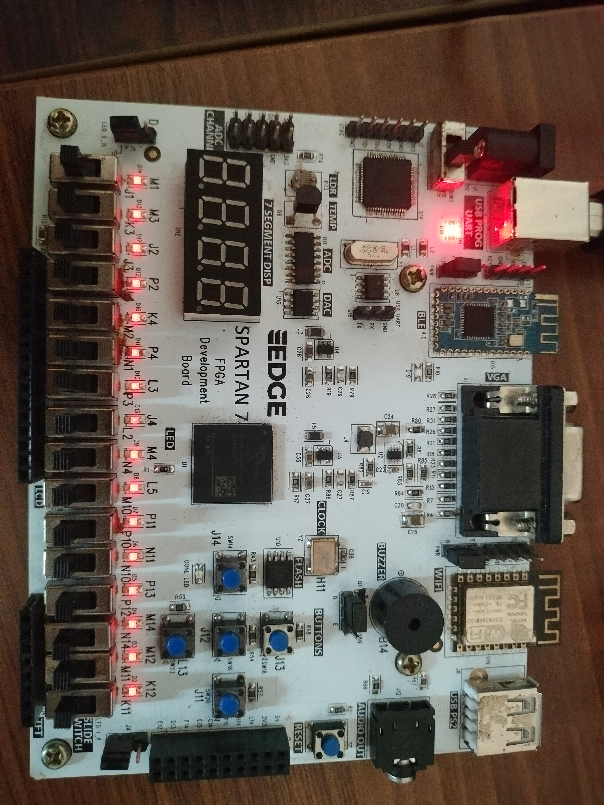
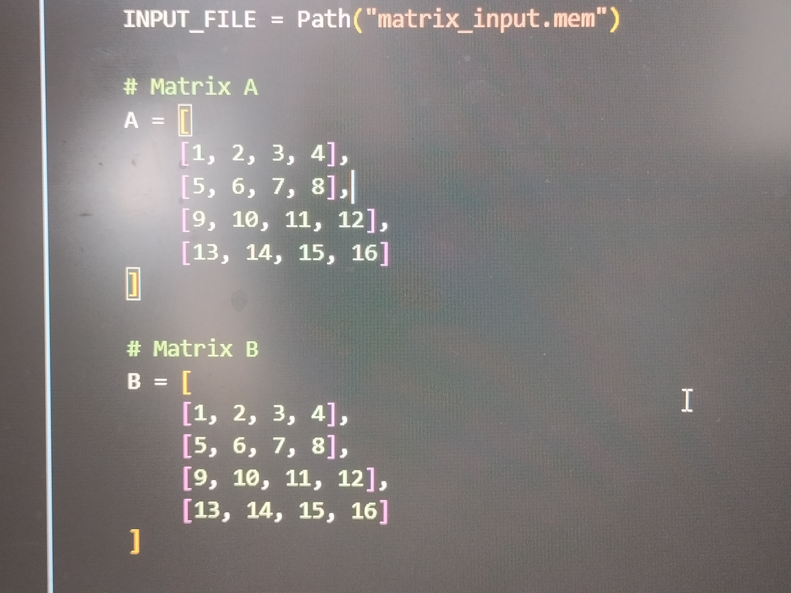
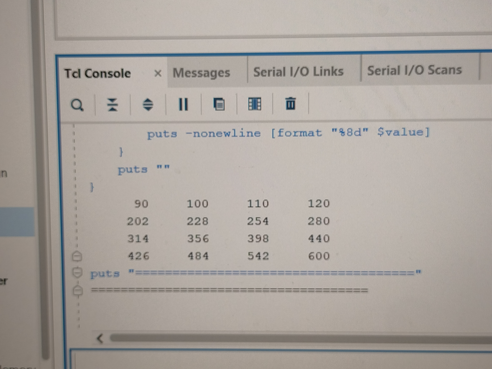

# 4x4 Systolic Array Matrix Multiplier

A Verilog implementation of a signed 4x4 matrix multiplier for a Spartan-7
FPGA. The datapath is a 4x4 array of processing elements (PEs), with a
controller that captures and skews the matrix operands and result storage that
holds the completed matrix. Vivado Virtual I/O (VIO) is the implemented
laptop-facing hardware interface.

## Project overview

The design calculates `C = A x B`. Each input matrix has 16 signed 8-bit
elements. Each of the 16 output elements is a signed 32-bit multiply-
accumulate (MAC) result:

```text
C[row][column] = sum(A[row][k] * B[k][column]) for k = 0..3
```

`sys_array_4x4` instantiates one `pe` for each matrix coordinate. A values
travel horizontally between PEs in a row through registered `a_out` signals;
B values travel vertically through registered `b_out` signals. Each PE
multiples its signed 8-bit inputs and accumulates the product in a signed
32-bit `acc` register. The PE operand registers provide the hop-by-hop
pipeline movement; the design does not have a separate shift-register module.

`matrix_skew_controller` captures the 128-bit packed matrices in `A_reg` and
`B_reg` after detecting a rising edge of `start`. Its `IDLE`, `CLEAR`, `RUN`,
and `DONE` states clear the PE accumulators and issue skewed rows of A and
columns of B over `a_row_in` and `b_col_in`. When the run completes, `done`
indicates completion. `result_storage` captures the 512-bit array result into
`result_out` and asserts `result_valid`.

The top-level design exposes the input and result signals through the
`vio_matrix` IP. There is no UART receiver in the RTL. The serial utility
`matrix_sender.py` is therefore not connected to this top-level design.

## Target hardware and tools

| Parameter | Specification |
| --- | --- |
| EDA tool | AMD Xilinx Vivado 2025 |
| FPGA family | Spartan-7 |
| FPGA device | XC7S15 |
| Package | FTGB196ABX2409 |
| Board marking | D4ASM701A |
| Constraint target string | `xc7s15ftgb196-1` |
| Board clock constraint | 50 MHz |
| Reset | Active-high, pin J13 |
| Result presentation | Laptop through Vivado VIO / Tcl Console |

The XDC assigns the board clock to H11 with a 20 ns period (50 MHz) and reset
to J13. The simulation testbench separately generates a 100 MHz clock.



## Repository structure

```text
.
├── bitstream/
│   └── top_fpga.bit
├── constraints/
│   └── top_fpga.xdc
├── docs/
│   ├── fpga_board_setup.jpg
│   ├── input_matrices.jpg
│   └── simulation_result_matrix.jpg
├── ip/
│   └── vio_matrix/
│       └── vio_matrix.xci
├── rtl/
│   ├── PE.v
│   ├── matrix_skew_controller.v
│   ├── module.v
│   ├── result_storage.v
│   ├── sys_array_4x4.v
│   └── top_fpga.v
├── sim/
│   └── top_fpga_vio_tb.v
├── matrix_sender.py
└── tcl_command.txt
```

### HDL modules and project files

| File | Purpose |
| --- | --- |
| `rtl/PE.v` | Signed 8-bit multiplication, 32-bit accumulation, and registered operand forwarding in one PE. |
| `rtl/sys_array_4x4.v` | Generates the 4x4 PE grid and wires A horizontally and B vertically. |
| `rtl/matrix_skew_controller.v` | Captures matrices, detects `start`, generates skewed array inputs, and controls the `IDLE`/`CLEAR`/`RUN`/`DONE` sequence. |
| `rtl/result_storage.v` | Captures the 512-bit output and drives `result_valid`. |
| `rtl/top_fpga.v` | Connects `vio_matrix`, the controller, and result storage. |
| `rtl/module.v` | Empty placeholder module; it is not instantiated in the active datapath. |
| `ip/vio_matrix/vio_matrix.xci` | Vivado configuration for the VIO IP used by `top_fpga`. |
| `sim/top_fpga_vio_tb.v` | Testbench that reads `matrix_input.mem`, drives the VIO probes, waits for completion, prints results, and writes `matrix_output.mem`. |
| `constraints/top_fpga.xdc` | Pin assignments and 50 MHz clock constraint. |
| `bitstream/top_fpga.bit` | Included bitstream. Its build provenance and exact source revision are not recorded in this repository. |

The VIO configuration and RTL use three VIO output probes (A, B, and start)
and four VIO input probes (two 256-bit result portions, `result_valid`, and
`busy`).

## Vivado 2025 setup and FPGA implementation

The repository does not include a Vivado `.xpr` project, so create the project
once and add the supplied design sources and IP. The steps below describe the
GUI flow from a new project through programming the FPGA.

### 1. Create a Vivado project

1. Start **Vivado 2025** and select **Create Project**.
2. Choose a project name and a project directory. Keep the project directory
   separate from the source folders or use the repository root as the project
   location; do not move or rename the repository files.
3. Select **RTL Project**. You may leave **Do not specify sources at this
   time** unchecked and add the sources in the next step.
4. On **Default Part**, search for and select `xc7s15ftgb196-1`, the target
   part string used in the supplied XDC. If your Vivado installation offers a
   matching board definition, select it; otherwise use the part selection.
5. Finish project creation.

### 2. Add the HDL, VIO IP, and constraints

1. In **Flow Navigator → Project Manager → Add Sources**, choose **Add or
   create design sources**.
2. Add these design files from `rtl/`:
   `PE.v`, `sys_array_4x4.v`, `matrix_skew_controller.v`,
   `result_storage.v`, and `top_fpga.v`.
   `module.v` is an empty placeholder and is not part of the active hierarchy.
3. Add `ip/vio_matrix/vio_matrix.xci` as the existing IP source. In the
   **IP Sources** view, generate its output products. The instantiated IP
   module must be named `vio_matrix` and must match the connections in
   `top_fpga.v`: output probes `probe_out0` and `probe_out1` are 128 bits,
   `probe_out2` is 1 bit; input probes `probe_in0` and `probe_in1` are
   256 bits each, and `probe_in2` and `probe_in3` are 1 bit each.
4. Choose **Add or create constraints** and add
   `constraints/top_fpga.xdc`. It assigns `clk` to H11 with a 20 ns clock
   period and active-high `rst` to J13.
5. In **Sources**, right-click `top_fpga` and select **Set as Top**.
   `top_fpga` is the hardware design top; the testbench is only the simulation
   top.
6. Select **Tools → Validate Design** (or run elaboration) and resolve any
   missing-source, missing-IP, or port-width errors before proceeding.

### 3. Run behavioral simulation first

1. Add `sim/top_fpga_vio_tb.v` under **Add Sources → Add or create simulation
   sources**.
2. Right-click `top_fpga_vio_tb` in the simulation sources and select **Set
   as Top** for simulation.
3. Create `matrix_input.mem` with two 128-bit hexadecimal lines and place it
   in the simulator's working directory. The testbench reads this filename
   directly. For the example matrices containing 1 through 16 in row-major
   order, use:

   ```text
   100f0e0d0c0b0a090807060504030201
   100f0e0d0c0b0a090807060504030201
   ```

   Each line packs 16 bytes with matrix element `[0][0]` in the least
   significant byte. Negative signed 8-bit values must be encoded in
   two's-complement form.
4. Confirm the VIO simulation model is available after generating the IP
   output products. Select **Run Simulation → Run Behavioral Simulation**.
5. Run until the testbench finishes. It drives the VIO output probes, waits
   for `probe_in2` (`result_valid`), prints the result in its simulation
   console, and writes `matrix_output.mem`.
6. Add these hierarchy signals to the waveform if needed:
   `clk`, `rst`, `dut.vio_inst.probe_out0`,
   `dut.vio_inst.probe_out1`, `dut.vio_inst.probe_out2`,
   `dut.controller_inst.busy`, `dut.controller_inst.done`,
   `dut.vio_inst.probe_in0`, `dut.vio_inst.probe_in1`, and
   `dut.vio_inst.probe_in2`.

The testbench uses a 100 MHz simulated clock, whereas the board XDC specifies
50 MHz. The testbench waits for a valid result and prints it, but it does not
perform an automatic golden-matrix comparison.

### 4. Synthesize, implement, and generate the bitstream

1. Before building the hardware, set `top_fpga` as the active design top again
   (not `top_fpga_vio_tb`).
2. In **Flow Navigator → Synthesis**, click **Run Synthesis** and accept the
   default run settings unless your project requires different settings.
3. When synthesis completes, inspect the run messages for errors and open the
   synthesized design to confirm the `vio_matrix`, controller, systolic array,
   and result-storage hierarchy is present.
4. Click **Run Implementation**. Allow Vivado to run its implementation
   steps through placement and routing. Review the timing summary and DRC
   messages. Fix errors reported by Vivado before generating a bitstream.
5. When implementation completes successfully, click **Generate Bitstream**.
   The generated `.bit` file is normally in the Vivado project run directory
   (for example, `project_name.runs/impl_1/`). The repository also contains
   `bitstream/top_fpga.bit`; its build provenance is not recorded here.

### 5. Program the board and use laptop-side VIO

1. Connect and power the Spartan-7 board, then open **Open Hardware Manager**
   in Vivado.
2. Select **Open Target → Auto Connect**. If prompted, install or select the
   appropriate hardware cable/target.
3. Select **Program Device** and choose the bitstream produced by the
   implementation flow. Wait for programming to complete.
4. Open the VIO dashboard for `vio_matrix`. Set `probe_out0` and
   `probe_out1` to the packed 128-bit hexadecimal input words. Set
   `probe_out2` low, then pulse it high and low to start a multiplication.
5. Watch `probe_in3` (`busy`) while the operation runs and wait for
   `probe_in2` (`result_valid`) to assert.
6. In the Vivado Tcl Console, source the existing Hardware Manager script:

   ```tcl
   source tcl_command.txt
   ```

   The script refreshes the VIO values and prints the 4x4 result in the laptop
   Tcl Console. The VIO dashboard/Tcl Console is the documented output path;
   the RTL does not contain a UART output interface.

## Matrix inputs and laptop interface

### FPGA hardware operation

For board use, `top_fpga` receives A and B as 128-bit vectors from the
`vio_matrix` Virtual I/O core in Vivado Hardware Manager. Each matrix is
row-major in the packed vector: the first matrix element is in bits `[7:0]`,
the next in `[15:8]`, and so on. The source stores each element as signed
8-bit two's-complement data. The VIO `start` probe begins an operation.

The result is available on the laptop through the VIO input probes:
`probe_in0` carries `result_out[255:0]`, `probe_in1` carries
`result_out[511:256]`, and the other probes expose `result_valid` and `busy`.
The Tcl commands in `tcl_command.txt` read the VIO values and print the 4x4
matrix in the Vivado Tcl Console. No TFT or other board display is part of the
documented output path.

### Serial helper (separate from the RTL interface)

`matrix_sender.py` is a standalone PySerial sender. It defines two 4x4 Python
lists, checks that their entries fit in the signed 8-bit range, converts each
value to one byte using two's-complement representation, and transmits 32
bytes total: 16 row-major bytes for A followed by 16 row-major bytes for B.
The checked-in settings are `PORT = "COM3"` and `BAUD = 9600`.

Install the `pyserial` dependency in the Python environment, connect the
appropriate serial device, update `PORT` in the script if needed, and run:

```bash
python matrix_sender.py
```

The script sends bytes and prints a transmission confirmation. It does not
read or display a response. Since none of the current RTL modules implements a
UART receiver, this serial path is not a means of entering matrices into the
included `top_fpga` design or receiving its result. For the implemented FPGA
flow, use Vivado VIO; for the testbench, provide the `.mem` file described
below.

## Vivado 2025 behavioral simulation

There is no Vivado `.xpr` project file or `matrix_input.mem` checked in. The
testbench expects `matrix_input.mem` in the simulator's working directory. It
contains two 128-bit hexadecimal words in `$readmemh` order: A first, then B.
To create a vector file without adding a repository helper, prepare each
matrix as 16 signed 8-bit two's-complement bytes in row-major order, pack the
first element into the least-significant byte, and write one 32-hex-digit word
per matrix. For the example matrices in the screenshot (both matrices contain
1 through 16 in row-major order), each word is:

```text
100f0e0d0c0b0a090807060504030201
100f0e0d0c0b0a090807060504030201
```

Run the behavioral simulation as follows:

1. Open AMD Xilinx Vivado 2025.
2. Open the existing project if available, or create a project for the
   Spartan-7 target `xc7s15ftgb196-1`. No project file is included here.
3. Add the Verilog design sources from `rtl/`. Add
   `ip/vio_matrix/vio_matrix.xci` and generate its output products.
4. Add `sim/top_fpga_vio_tb.v` to the simulation sources.
5. Add `matrix_input.mem` to the simulation sources or copy it to the
   simulation working directory used for `$readmemh`.
6. Set `top_fpga` as the synthesis top and `top_fpga_vio_tb` as the simulation
   top.
7. Launch **Run Behavioral Simulation** and run until the testbench finishes.
8. Inspect `clk`, `rst`, `dut.vio_inst.probe_out0`, `probe_out1`,
   `probe_out2`, `dut.controller_inst.busy`, `dut.controller_inst.done`,
   `dut.vio_inst.probe_in0`, `probe_in1`, and `probe_in2` in the waveform.
9. Read the printed **RESULT MATRIX C** in the Vivado simulation console. The
   testbench also writes the packed 512-bit result to `matrix_output.mem`.

The testbench detects an input file with unknown bits, waits up to 30 clock
edges for `result_valid`, and reports a timeout or output-file error. It does
not calculate a golden reference or compare the result automatically; verify
the displayed result against the expected result for the chosen input vectors.

## Vivado Tcl Console and result display

The existing `tcl_command.txt` is a Hardware Manager VIO readout, not a
behavioral-simulation launcher. Preserve and use it after programming the
board and opening the hardware target in Vivado:

1. Open **Hardware Manager**, connect to the target, and program the FPGA.
2. Ensure the VIO core appears as `hw_vio_1` and its result probes are named
   `result_out` and `result_out_1`, as expected by the Tcl file.
3. Use the VIO dashboard to enter the two matrices and pulse `start`.
4. Wait for `result_valid`, then run `source tcl_command.txt` in the Vivado
   Tcl Console.
5. Read the four rows printed under **RESULT MATRIX C** in the Vivado Tcl
   Console on the laptop.

The Tcl file calls `refresh_hw_vio`, reads each result probe's `INPUT_VALUE`,
concatenates the two probe values, extracts sixteen 32-bit words, and prints
them as decimal integers. It does not launch simulation or access a simulator
hierarchy. Its current formatting does not explicitly convert a 32-bit
two's-complement value to signed decimal; the example output shown is
non-negative.

For behavioral simulation, the testbench itself prints the matrix and writes
`matrix_output.mem`; `tcl_command.txt` is not used by that simulation flow.

## Images

The input example shows the row-major 4x4 matrices used in the project.



The output example shows a 4x4 result printed in the Vivado Tcl Console on the
laptop.



## End-to-end workflow

```text
Vivado laptop VIO dashboard
    -> 128-bit Matrix A and Matrix B probes
    -> top_fpga / matrix_skew_controller
    -> skewed row and column data
    -> sys_array_4x4 (16 processing elements)
    -> signed multiply-and-accumulate operations
    -> result_storage (512-bit result and result_valid)
    -> VIO result probes
    -> Vivado Tcl Console on the laptop
```

The serial sender is a separate utility and is not connected to this
implemented data path. Simulation results are displayed in Vivado's simulation
console; board results are read through VIO and displayed in Vivado's Tcl
Console on the laptop.
